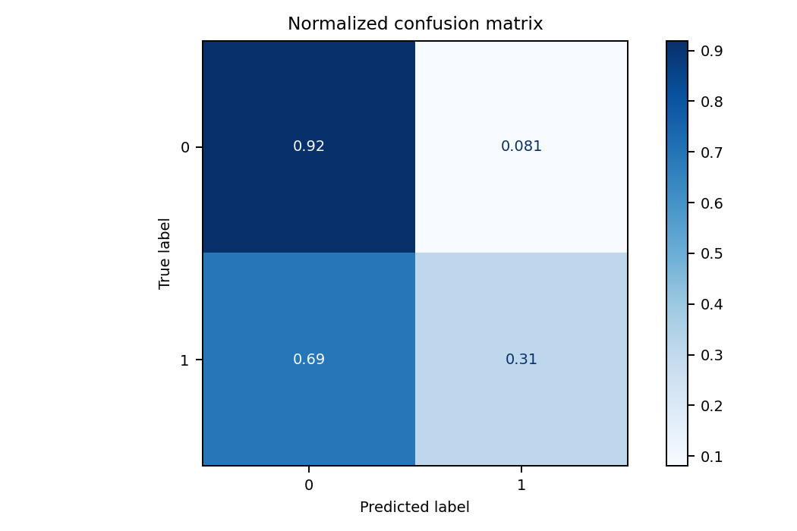
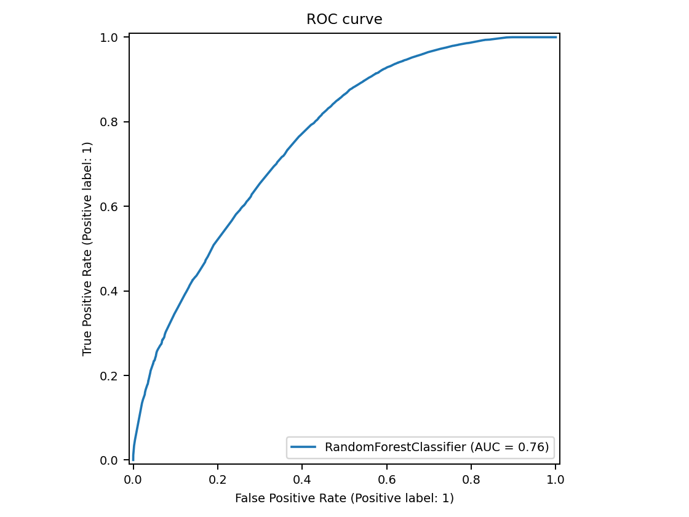
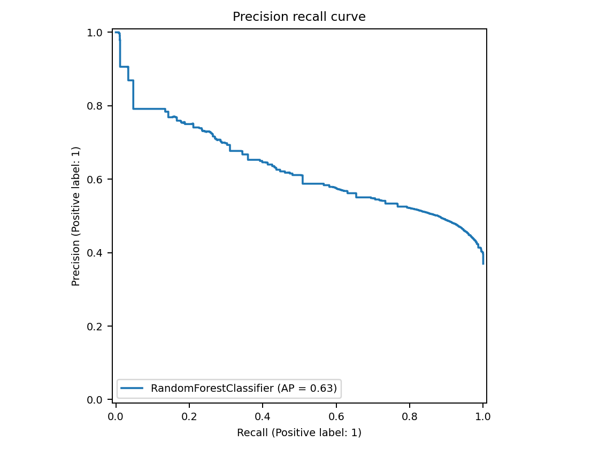
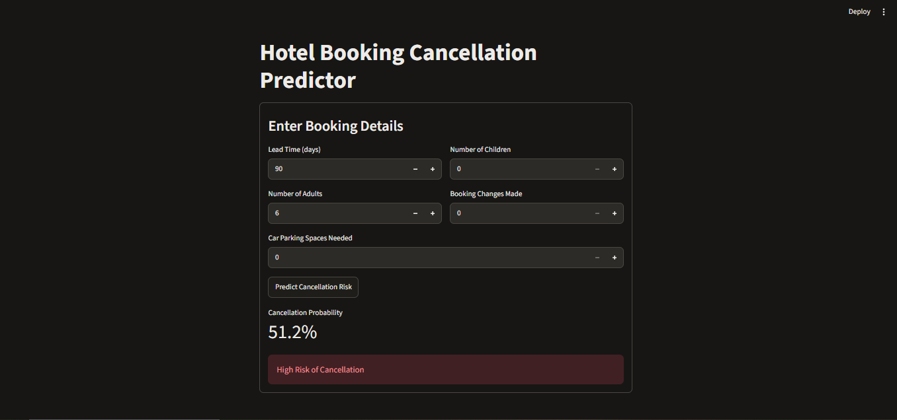

# Hotel Booking Cancellation Predictor

An end-to-end machine learning application that predicts whether a hotel booking will be cancelled. A **Random Forest** model is served through a **FastAPI** REST API, used by a **Streamlit** web interface, and tracked with **MLflow**.

## Features

- **Random Forest classifier** (scikit-learn) trained to predict booking cancellations, evaluated with a **confusion matrix**.
- **REST API (FastAPI)** with a `/predict` endpoint returning the cancellation decision and probability, plus a health check endpoint.
- **Interactive web app (Streamlit)** where users enter booking details and see the cancellation probability with a Low / High risk indicator.
- **Experiment tracking (MLflow)** for logging runs and model artifacts.
- Input validation with Pydantic.

## Architecture

```
Streamlit UI  ──POST /predict──►  FastAPI backend  ──►  Random Forest model (ml/model.pkl)
 (frontend/)                       (backend/)                      ▲
                                                                   │
                                                      MLflow experiment tracking
```

## Model Inputs

| Feature | Description |
|---|---|
| `lead_time` | Days between booking and arrival |
| `adults` | Number of adults |
| `children` | Number of children |
| `booking_changes` | Number of changes made to the booking |
| `required_car_parking_spaces` | Parking spaces requested |

## API

**`POST /predict`**

```json
// Request
{
  "lead_time": 50,
  "adults": 2,
  "children": 0,
  "booking_changes": 0,
  "required_car_parking_spaces": 0
}

// Response
{
  "will_cancel": false,
  "cancellation_probability": 0.27
}
```

**`GET /`** returns `{"status": "healthy"}`.

Interactive API docs are available at `/docs` when the server is running.

## Model & Results

**Model:** Random Forest classifier (scikit-learn), logged with MLflow as `Production_RF_Model`.

| Hyperparameter | Value |
|---|---|
| `n_estimators` | 100 |
| `max_depth` | 8 |
| `max_features` | sqrt |
| `criterion` | gini |
| `random_state` | 42 |

**Metrics (logged by MLflow, computed on the training data):**

| Metric | Value |
|---|---|
| Accuracy | 0.694 |
| Precision (weighted) | 0.694 |
| Recall (weighted) | 0.694 |
| F1 score (weighted) | 0.657 |
| ROC AUC | 0.760 |
| Log loss | 0.547 |

> These are training-set metrics. The model is intentionally simple (5 input features, shallow trees). Adding more booking features (hotel type, country, deposit type, market segment) and evaluating on a held-out test set are the natural next steps.

| Confusion matrix | ROC curve | Precision-Recall curve |
|---|---|---|
|  |  |  |

## Screenshots

| Streamlit app | FastAPI docs | MLflow runs |
|---|---|---|
|  |  |  |

## Quick Start

1. Install dependencies:
   ```bash
   pip install -r requirements.txt
   ```
2. Run the services (three terminals):
   ```bash
   # Terminal 1 - MLflow tracking
   mlflow ui --backend-store-uri mlruns/ --port 5000

   # Terminal 2 - Backend API
   uvicorn backend.main:app --reload

   # Terminal 3 - Frontend
   streamlit run frontend/streamlit_app.py
   ```
3. Open:
   - MLflow UI: http://localhost:5000
   - FastAPI docs: http://localhost:8000/docs
   - Streamlit app: http://localhost:8501

The frontend reads the API address from the `API_URL` environment variable (default `http://localhost:8000/predict`).

## Project Structure

```
ml_app_assignment/
├── ml/                 # Model training and saved model
├── backend/            # FastAPI implementation
├── frontend/           # Streamlit interface
├── mlflow_tracking/    # Experiment tracking
├── mlruns/             # MLflow run data
├── requirements.txt
└── README.md
```

## Tech Stack

Python · scikit-learn · Random Forest · FastAPI · Pydantic · Streamlit · MLflow · pandas · NumPy
